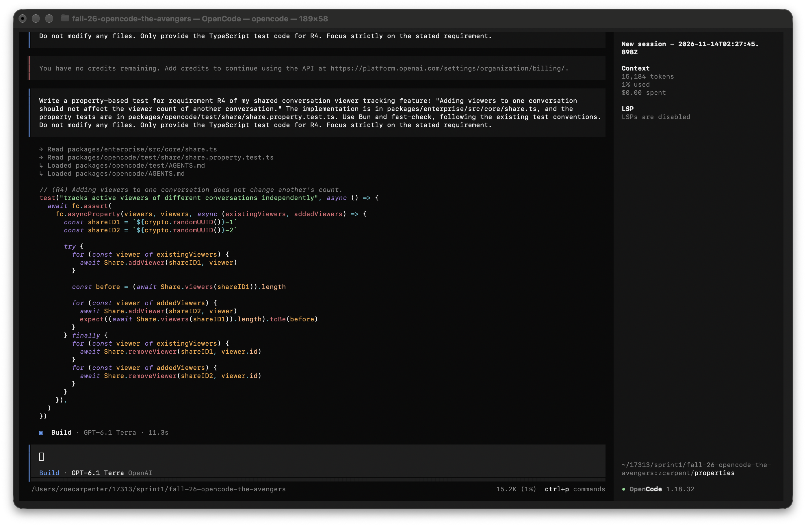
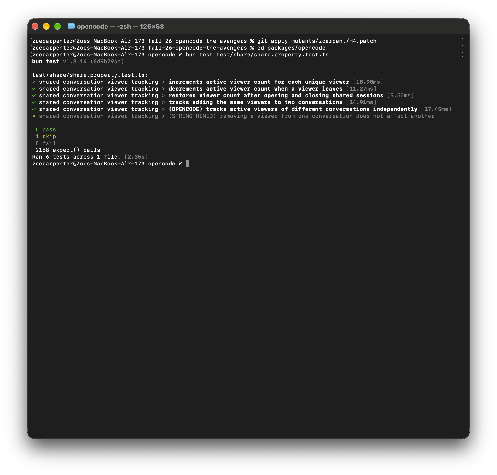
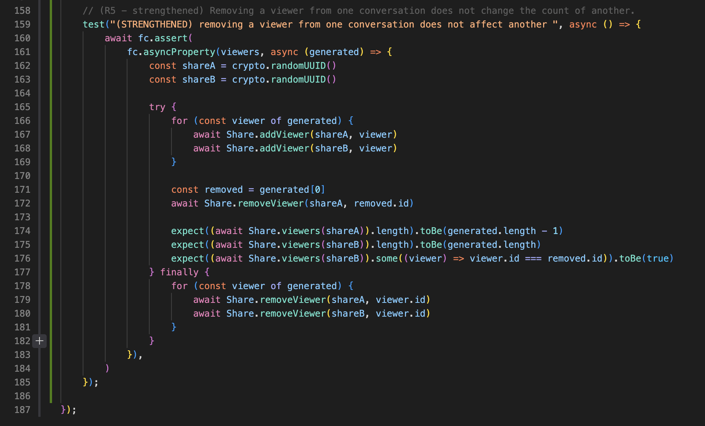
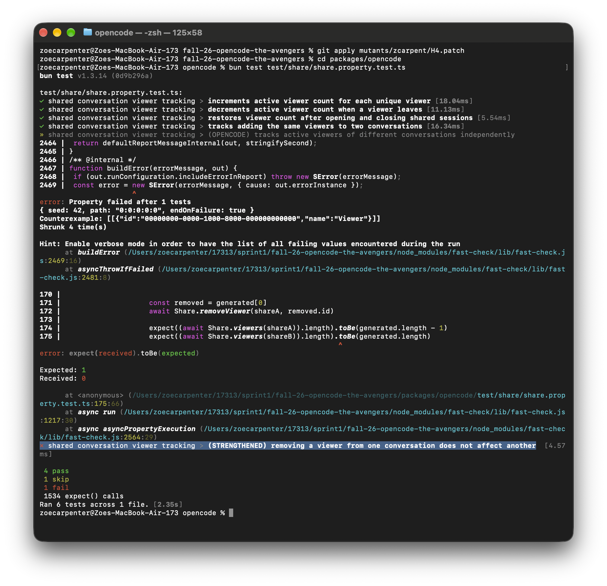

# Traceability: Zoe Carpenter (zcarpent)

**Target feature:** Shared Conversation Viewer Tracking

## Requirements

| ID | Interview evidence | Requirement | Acceptance criteria | Changed in P4? | Property (kind) | Test |
|---|---|---|---|---|---|---|
| R1 | O-3 | Each new unique viewer increases the viewer count by one. | Registering five viewers with unique IDs results in a viewer count of five. Each registration increases the count by exactly one. | Yes | Invariant: Each unique viewer increases the count by one. | `increments active viewer count for each unique viewer` |
| R2 | O-5 | Removing an active viewer decreases the count by one. | Registering five viewers and removing one results in a viewer count of four. Each removal decreases the count by exactly one. | Yes | Invariant: Removing an active viewer decreases the count by one. | `decrements active viewer count when a viewer leaves` |
| R3 | O-5 | Adding and then removing viewers should restore the original count. | Registering five viewers and removing all five restores the original count. | New | Round-trip: Adding and removing the same viewers restores the original count. | `restores viewer count after opening and closing shared sessions` |
| R4 | O-4 | Adding viewers to one conversation should not affect another conversation. | Registering three viewers to one conversation and five to another results in independent counts of three and five. | New | Metamorphic: Adding viewers to one conversation does not change another's count. | `tracks adding the same viewers to two conversations` |
| R5 | O-4 | Removing a viewer from one conversation should not affect another conversation. | Registering the same five viewers to two conversations and removing one from the first results in counts of four and five. | New | Metamorphic: Removing a viewer from one conversation does not change another's count. | `(STRENGTHENED) removing a viewer from one conversation does not affect another` |

## Requirement Changes

| ID | Original requirement (P3) | Revised requirement | Why it changed |
|---|---|---|---|
| R1 | Each time someone successfully opens a shared conversation, a new access event should be recorded. | Each new unique viewer increases the viewer count by one. | The implementation tracks active viewers rather than cumulative access events. |
| R2 | The displayed access count should match the number of recorded access events. | Removing an active viewer decreases the count by one. | Active viewer counts must decrease when viewers leave. |
| R3 | New requirement. | Adding and removing viewers restores the original count. | Verifies that registration and removal do not leave stale records. |
| R4 | New requirement. | Adding viewers to one conversation does not affect another. | Ensures independent viewer tracking across conversations. |
| R5 | New requirement. | Removing viewers from one conversation does not affect another. | Ensures removal does not affect the same viewer in another conversation. |

## Property-Based Testing

**R1 — Invariant: Incrementing active viewer count**

Generate unique viewers, register each one, and verify that the count increases by exactly one after each registration.

**R2 — Invariant: Decrementing active viewer count**

Register generated viewers, remove them one at a time, and verify that each removal decreases the count by one.

**R3 — Round-trip: Restoring the original viewer count**

Register and then remove all generated viewers. Verify that the final count equals the initial count.

**R4 — Metamorphic: Independent viewer tracking across conversations**

Register the same generated viewers in two different conversations. Verify that adding viewers to the second conversation does not change the first conversation's count.

**R5 — Metamorphic: Independent viewer removal across conversations**

Register the same viewers in two conversations, remove one from the first, and verify that the second conversation's count and viewer membership remain unchanged. This property was added after H4 survived the initial tests.

## Generators

- **Viewer IDs:** `fc.uuid()` generates random viewer identifiers.
- **Viewer lists:** `fc.uniqueArray(fc.uuid(), { minLength: 1, maxLength: 15 })` generates lists of 1–15 unique IDs.
- **Viewer objects:** IDs are mapped to objects with an `id` and the name `"Viewer"`.
- **Conversation IDs:** `crypto.randomUUID()` generates distinct conversation identifiers.
- **Independent conversations:** Generated viewers are registered in multiple conversations to test isolation.

## Test Implementation

The test suite contains six property-based tests: the original R1–R4 tests, an OpenCode-generated R4 test, and the strengthened R5 test.

The tests are implemented in:

`packages/opencode/test/share/share.property.test.ts`

They use **Bun and fast-check**, with a fixed random seed of 42.

To run the tests from `packages/opencode`:

```bash
bun test test/share/share.property.test.ts
```

## Properties Written or Suggested by AI Tools

ChatGPT assisted with identifying property-based testing patterns and developing the original R1–R4 tests, including two invariants, one round-trip property, and one metamorphic property. OpenCode generated an additional R4 property that tested independent viewer registration. After H4 survived, I added the strengthened R5 property to test independent viewer removal.

## Hand-Written Mutants with Predictions

| ID | Requirement targeted | Change | Predicted killer and reasoning | Actual result |
|---|---|---|---|---|
| H1 | R1 | Changed `addViewer()` to use `viewer.name` instead of `viewer.id` as the storage key. Since all generated viewers have the name `"Viewer"`, each new registration overwrites the previous viewer's record instead of creating a separate entry. | **R1:** Adding a second unique viewer will not increase the count because both viewers share the same storage key. | Killed by R1, R2, R3, R4 |
| H2 | R2 | Removed `shareID` from the storage key in `removeViewer()`. The removal operation now looks for a key that does not match the one used by `addViewer()`, leaving the viewer's record in storage. | **R2, R3:** R2 should detect that removing a viewer does not decrease the count. R3 should detect that adding and removing viewers fails to restore the original count. | Killed by R2, R3 |
| H3 | R4 | Changed `viewers()` to list all records with the prefix `["share_viewer"]` instead of `["share_viewer", shareID]`. As a result, it retrieves viewers belonging to other conversations. | **R4:** Adding viewers to the second conversation will incorrectly increase the count returned for the first conversation, violating independent viewer tracking. | Killed by R4 |
| H4 | R5 | Changed `removeViewer()` to search across all conversations and remove every record matching the given viewer ID, ignoring `shareID`. Removing a viewer from one conversation therefore removes that viewer from other conversations as well. | **None initially:** R1–R4 do not verify that removing a viewer from one conversation leaves other conversations unchanged. The new R5 property should detect this behavior. | Initially survived; killed by R5 |
| H5 | R3 | Changed `removeViewer()` to remove a viewer only when more than one viewer remains in the conversation. This prevents the final viewer from being removed, leaving one active viewer even after everyone has left. | **R2, R3:** R2 should detect that removing the last viewer does not decrease the count. R3 should detect that the final count remains one instead of returning to zero. | Killed by R2, R3 |

## Stryker Comparison

Stryker killed **14/16 mutants (87.5%)**, while my handwritten mutants initially scored **4/5 (80%)**. Stryker did not generate H4 or H5 because they required more complex behavioral changes rather than simple syntactic mutations.

Both surviving Stryker mutants modified the `undefined` filter in `viewers()`, potentially allowing missing storage records to appear in the results. These are plausible bugs I had not considered. Handwritten mutants exposed requirement-specific bugs, while Stryker revealed edge cases involving storage reads.

## Strengthening and Final Results

After adding R5, all **5 handwritten mutants were killed (100%)**. Stryker's score remained **87.5% (14/16)** because the tests do not simulate missing storage records.

The two surviving Stryker mutants are not equivalent because they could return `undefined` values that the original implementation filters out. Therefore, **0 mutants were excluded as equivalent**, and the equivalent-adjusted score remains **87.5%**.

## Agent Failure Case

### OpenCode-Generated Property

I asked OpenCode to generate a property-based test for R4: "Adding viewers to one conversation should not affect the viewer count of another conversation."

**OpenCode transcript:**



### Surviving Mutant: H4

The OpenCode-generated R4 property registers viewers in two conversations and verifies that adding viewers to the second conversation does not change the first conversation's count.

However, handwritten mutant H4 modifies `removeViewer()` to remove matching viewer IDs from all conversations rather than only the specified conversation.

**Why the property was too weak:** The generated property checks isolation during registration but not removal. Although it calls `removeViewer()` during cleanup, it does not assert that other conversations remain unchanged. Therefore, H4 survives.

**OpenCode-generated property let H4 survive:**



### Strengthened Property: R5



I added a new metamorphic property that registers the same generated viewers in two conversations, removes one viewer from the first conversation, and verifies that the second conversation's count and viewer membership remain unchanged.

This strengthens the suite by testing isolation during removal, which the OpenCode-generated property did not cover.

### Strengthened Property Kills H4



With H4 applied, removing a viewer from conversation A also incorrectly removed that viewer from conversation B. Fast-check shrank the failure to a single viewer, demonstrating that R5 kills H4.

With the original implementation restored, the strengthened property passed.

**Conclusion:** The OpenCode-generated property correctly tested R4 but did not cover removal isolation. Adding R5 exposed the missing behavior and killed H4.